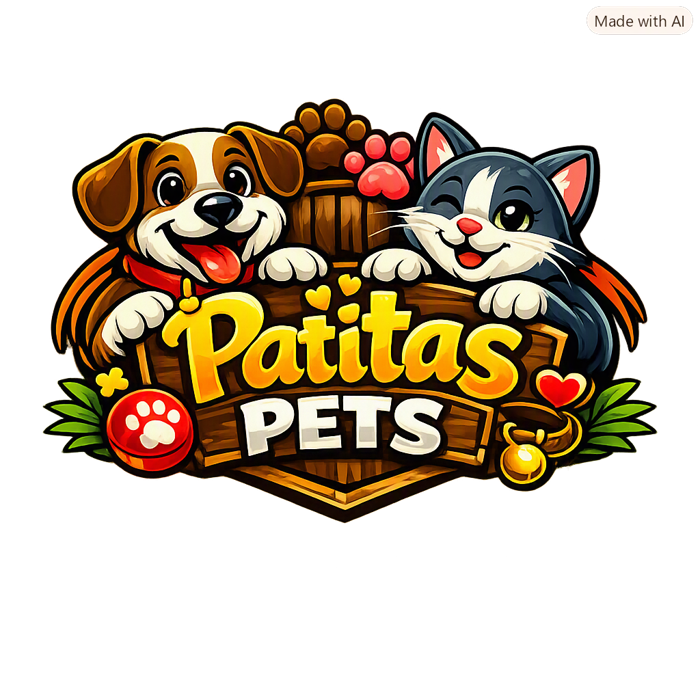
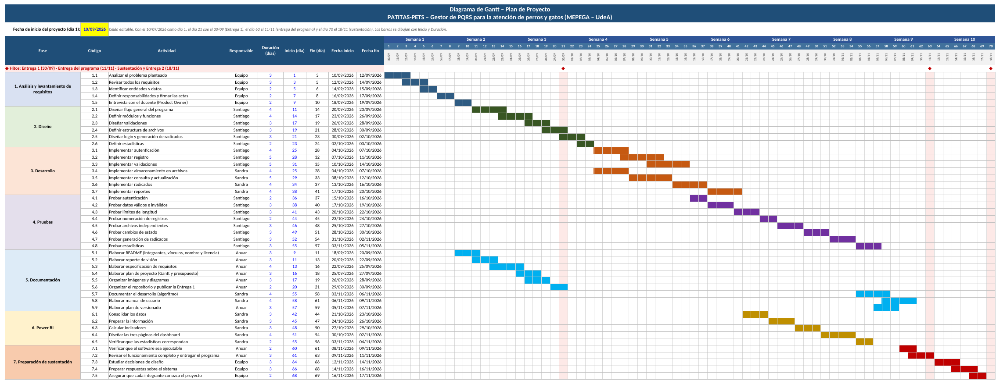
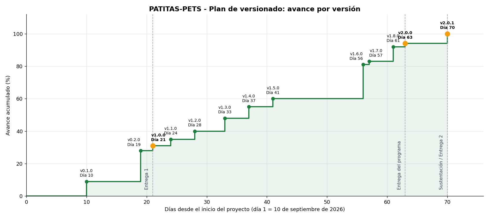

<p align="center">
  
</p>

<h1 align="center">PATITAS-PETS · Gestor de PQRS de MEPEGA</h1>

<p align="center">
  Proyecto Integrador · Algoritmia y Programación 2026-2<br>
  Facultad de Ingeniería · Departamento de Ingeniería Industrial · Universidad de Antioquia<br>
  Docente: Victor Hugo Mercado Ramos
</p>

<p align="center">
  <a href="https://creativecommons.org/licenses/by-nc-sa/4.0/deed.es"></a>
</p>

> **Estado actual:** versión 2.0.0 del software. Incluye autenticación, registro validado de PQRS, consecutivos independientes por archivo que continúan la numeración de las bases de MEPEGA, radicado de 120 columnas, consultas, cambios de estado con historial, estadísticas y exportación para Power BI.

---

## Tabla de contenido

1. [Integrantes](#1-integrantes)
2. [Vínculos académicos y descripción](#2-vínculos-académicos-y-descripción)
3. [Nombre del proyecto y detalles](#3-nombre-del-proyecto-y-detalles)
4. [Licencia del software](#4-licencia-del-software)
5. [Reporte de visión](#5-reporte-de-visión)
6. [Especificación de requisitos](#6-especificación-de-requisitos)
7. [Plan de proyecto](#7-plan-de-proyecto)
8. [Plan de versionado](#8-plan-de-versionado)
9. [Algoritmo](#9-algoritmo)
10. [Manual de usuario](#10-manual-de-usuario)
11. [GitHub](#11-github)
- [Estructura del repositorio](#estructura-del-repositorio)
- [Cómo ejecutar el programa](#cómo-ejecutar-el-programa)
- [Actas del equipo](#actas-del-equipo)

---

## 1. Integrantes

| Integrante | Programa académico | Rol dentro del proyecto |
|---|---|---|
| Anuar Ferney Caldón Quira | Ingeniería Industrial | Líder del proyecto: coordinación, análisis y documentación |
| Santiago Domínguez Padilla | Ingeniería Industrial | Desarrollo, validaciones y pruebas |
| Sandra Yulieth Salcedo Salazar | Ingeniería Industrial | Gestión de archivos, datos, reportes y Power BI |

El equipo trabaja de manera colaborativa, distribuyendo las actividades de acuerdo con las habilidades y responsabilidades establecidas en las [actas de entendimiento, colaboración y responsabilidad](#actas-del-equipo).

## 2. Vínculos académicos y descripción

Los tres integrantes pertenecen al programa de Ingeniería Industrial de la Universidad de Antioquia y cursan Algoritmia y Programación como parte de su formación.

### Anuar Ferney Caldón Quira
- **Programa académico:** Ingeniería Industrial.
- **Fortalezas:** liderazgo, organización, responsabilidad y coordinación del trabajo grupal.
- **Aporte al proyecto:** seguimiento de las actividades, organización del repositorio y coordinación general.

### Santiago Domínguez Padilla
- **Programa académico:** Ingeniería Industrial.
- **Fortalezas:** análisis lógico, resolución de problemas, pruebas, creatividad, interés por la programación y atención al detalle.
- **Aporte al proyecto:** diseño de las validaciones, apoyo en la lógica del sistema, ejecución de pruebas e identificación de errores.

### Sandra Yulieth Salcedo Salazar
- **Programa académico:** Ingeniería Industrial.
- **Fortalezas:** organización, manejo y análisis de información, trabajo colaborativo, comunicación, documentación y presentación de resultados.
- **Aporte al proyecto:** diseño y administración de los archivos planos, manejo de la información, documentación, reportes y análisis de resultados.

## 3. Nombre del proyecto y detalles

<p align="center"></p>

**PATITAS-PETS – Gestor de PQRS** es un software de consola orientado a la gestión organizada de Peticiones, Quejas, Reclamos y Sugerencias relacionadas con la atención de perros y gatos en la Universidad de Antioquia. Permite registrar y administrar las PQRS recibidas por diferentes canales, almacenar la información en archivos planos independientes, consultar los registros, actualizar su estado, generar comprobantes de radicación y obtener información estadística para apoyar el seguimiento de la atención.

El sistema está desarrollado en Python con una estructura modular (módulos y funciones separados por responsabilidad) y valida toda la información que digitan los usuarios. Los datos se consolidan para un tablero de control en Power BI. El logo muestra un perro y un gato, protagonistas de la atención veterinaria que apoya MEPEGA, junto con el nombre del software.

| Módulo | Qué hace |
|---|---|
| Autenticación | Ingreso con usuario o correo institucional; máximo 3 intentos; bloqueo de 30 segundos con cuenta regresiva; sesión activa visible en todas las pantallas. |
| Registro de PQRS | Captura guiada con validación de cada campo, menús numerados, opción `cancelar` y confirmación antes de guardar. |
| Almacenamiento | Cuatro archivos planos independientes con la misma estructura de 18 campos; el consecutivo continúa desde el 3001 en cada archivo. |
| Radicado | Comprobante con marco ASCII y líneas de exactamente 120 caracteres, guardado en `data/radicados/`. Ver [ejemplo](docs/ejemplo_radicado.txt). |
| Consultas | Por número de radicado (con historial de estados), por documento del solicitante, estado general, registros activos, más antiguas, próximas a vencer y vencidas. |
| Cambio de estado | Flujo obligatorio Registrada → En proceso → Solucionada, con observación, bitácora en `data/Historial.txt` y comprobante. |
| Estadísticas | Promedio de días de respuesta y cinco estadísticas adicionales en pantalla, reporte TXT y base consolidada CSV para Power BI. |

## 4. Licencia del software

Este proyecto se publica bajo la licencia **Creative Commons Atribución-NoComercial-CompartirIgual 4.0 Internacional (CC BY-NC-SA 4.0)**, seleccionada con el [selector de licencias de Creative Commons](https://chooser-beta.creativecommons.org/). Permite compartir y adaptar el material siempre que se reconozca la autoría original, no se use con fines comerciales y las obras derivadas se distribuyan bajo los mismos términos.

Texto completo: [LICENSE.md](LICENSE.md).

## 5. Reporte de visión

PATITAS-PETS reemplaza el registro manual en papel de las PQRS de MEPEGA por un sistema que garantiza consecutivos únicos, datos validados, trazabilidad del usuario que registra cada caso y control de los plazos de respuesta.

📄 [docs/01_reporte_vision.md](docs/01_reporte_vision.md)

## 6. Especificación de requisitos

Requisitos funcionales y no funcionales, reglas de validación por campo, modelo de datos de 18 campos, trazabilidad requisito–módulo y preguntas abiertas para el Product Owner.

📄 [docs/02_especificacion_requisitos.md](docs/02_especificacion_requisitos.md)

## 7. Plan de proyecto



| Concepto | Valor |
|---|---|
| Duración | 10 semanas (70 días): del 10 de septiembre al 18 de noviembre de 2026 |
| Actividades | 45, en 7 fases |
| Hitos | Entrega 1 (30/09) · entrega del programa (11/11) · sustentación y Entrega 2 (18/11) |
| Dedicación | 50 horas por integrante (150 horas en total) |
| Valor de la hora de práctica | $8.337,64 (1 SMMLV 2026 = $1.750.905 ÷ 210 h) |
| **Presupuesto total** | **$1.250.646 COP** en tiempo de práctica de formación |

📄 [docs/03_plan_proyecto.md](docs/03_plan_proyecto.md) · 📊 [Gant_PATITAS-PETS.xlsx](docs/entrega1/Gant_PATITAS-PETS.xlsx) · 📝 [Documento de la primera entrega](docs/entrega1/Patitas_Pets_Proyecto_Integrador_Ajustado.docx)

## 8. Plan de versionado

Versionado semántico (`MAYOR.MENOR.PARCHE`) con 13 versiones, desde la `v0.1.0` (día 10) hasta la `v2.0.1` (día 70, sustentación), cada una con su avance acumulado sobre el cronograma.



📄 [docs/04_plan_versionado.md](docs/04_plan_versionado.md)

## 9. Algoritmo

Todo el código está en la carpeta [`src/`](src): 11 módulos en Python que usan solo la biblioteca estándar.

| Módulo | Responsabilidad |
|---|---|
| `main.py` | Punto de entrada, menú principal y menú de estadísticas |
| `config.py` | Rutas, catálogos y reglas de negocio |
| `interfaz.py` | Banner, pantallas, tablas paginadas y lectura de la clave |
| `autenticacion.py` | Ingreso, intentos, bloqueo y sesión |
| `validaciones.py` | Reglas de validación de cada campo y del flujo de estados |
| `registro.py` | Registrar PQRS |
| `consultas.py` | Consultar PQRS |
| `cambios.py` | Registrar cambio de estado |
| `reportes.py` | Estadísticas y exportación para Power BI |
| `archivos.py` | Lectura y escritura de los archivos planos |
| `radicado.py` | Comprobante de 120 columnas |

📄 [docs/05_algoritmo.md](docs/05_algoritmo.md) — arquitectura, estructuras de datos, diagramas de flujo, pseudocódigo, pruebas y preguntas de repaso para la sustentación.

## 10. Manual de usuario

Guía paso a paso con capturas de pantalla: instalación, ingreso, registro, consultas, cambios de estado, estadísticas, archivos generados, configuración y solución de problemas.

📄 [docs/06_manual_usuario.md](docs/06_manual_usuario.md)

## 11. GitHub

Repositorio creado por el líder del proyecto con su cuenta institucional de la UdeA y compartido con Santiago y Sandra como colaboradores.

| Carpeta | Contenido |
|---|---|
| `src/` | Código fuente Python |
| `docs/` | Documentación, manual de usuario, actas y documentos de la primera entrega |
| `images/` | Logo, diagramas y capturas del manual |
| `data/` | `Peticion.txt`, `Queja.txt`, `Reclamo.txt`, `Sugerencia.txt`, usuarios, historial y archivos generados |

📄 [docs/07_guia_github.md](docs/07_guia_github.md)

---

## Estructura del repositorio

```
/
├── README.md
├── LICENSE.md
├── src/                          # Código fuente Python
│   ├── main.py                   # Punto de entrada y menú principal
│   ├── config.py                 # Rutas, catálogos y reglas de negocio
│   ├── interfaz.py               # Banner, pantallas, tablas y lectura de la clave
│   ├── autenticacion.py          # Login, intentos, bloqueo y sesión
│   ├── validaciones.py           # Reglas de validación y flujo de estados
│   ├── registro.py               # Opción 1: registrar PQRS
│   ├── consultas.py              # Opción 2: consultar PQRS
│   ├── cambios.py                # Opción 3: cambio de estado
│   ├── reportes.py               # Opción 4: estadísticas y Power BI
│   ├── archivos.py               # Lectura/escritura de los archivos planos
│   └── radicado.py               # Comprobante de 120 columnas
├── docs/                         # Documentación
│   ├── 01_reporte_vision.md
│   ├── 02_especificacion_requisitos.md
│   ├── 03_plan_proyecto.md
│   ├── 04_plan_versionado.md
│   ├── 05_algoritmo.md
│   ├── 06_manual_usuario.md
│   ├── 07_guia_github.md
│   ├── 08_guia_power_bi.md
│   ├── ejemplo_radicado.txt
│   ├── actas/                    # Actas del equipo (Markdown y Word)
│   ├── entrega1/                 # Documento de la primera entrega y Gantt en Excel
│   └── powerbi/                  # Tablero de Power BI
├── images/                       # Logo, diagramas y capturas del manual
└── data/                         # Archivos planos del programa
    ├── Peticion.txt
    ├── Queja.txt
    ├── Reclamo.txt
    ├── Sugerencia.txt
    ├── Usuarios.txt
    ├── Historial.txt             # Bitácora de cambios de estado
    ├── radicados/                # Radicados y comprobantes generados
    └── exportaciones/            # Reportes TXT y base CSV para Power BI
```

## Cómo ejecutar el programa

**Requisitos:** Python 3.10 o superior. No se necesitan librerías externas.

```bash
git clone https://github.com/[usuario-lider]/patitas-pets-pqrs.git
cd patitas-pets-pqrs
python src/main.py
```

- Ingrese con cualquier usuario activo de `data/Usuarios.txt`, ya sea con el nombre de usuario (por ejemplo, `admin_udea`) o con el correo institucional.
- Para ejecutar las pruebas de las reglas de validación y del flujo de estados: `python src/validaciones.py`
- Si la consola de su editor no muestra los asteriscos al escribir la clave, cambie `MOSTRAR_ASTERISCOS = False` en `src/config.py`.
- Instrucciones completas en el [manual de usuario](docs/06_manual_usuario.md).

## Actas del equipo

| Acta | Archivo |
|---|---|
| Acta de Entendimiento | [docs/actas/01_acta_entendimiento.md](docs/actas/01_acta_entendimiento.md) |
| Acta de Colaboración | [docs/actas/02_acta_colaboracion.md](docs/actas/02_acta_colaboracion.md) |
| Acta de Responsabilidad | [docs/actas/03_acta_responsabilidad.md](docs/actas/03_acta_responsabilidad.md) |
| Formato de acta de seguimiento | [docs/actas/04_plantilla_acta_seguimiento.md](docs/actas/04_plantilla_acta_seguimiento.md) |
| Versión en Word para firmar | [Patitas_Pets_Actas_Entendimiento_Colaboracion_Responsabilidad.docx](docs/actas/Patitas_Pets_Actas_Entendimiento_Colaboracion_Responsabilidad.docx) |

---

<sub>El nombre "MEPEGA" (Movimiento Estudiantil de Perritos y Gaticos) es una denominación ficticia de carácter humorístico utilizada con fines académicos, según el enunciado del curso.</sub>
