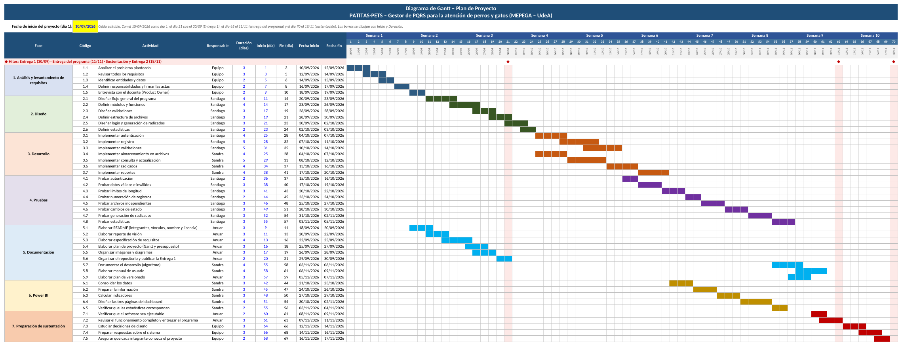
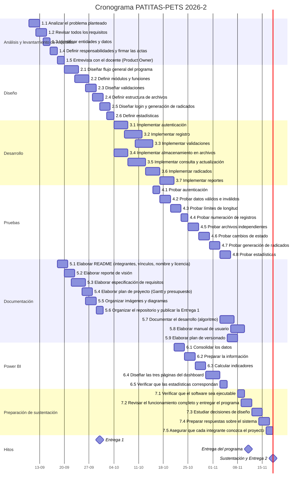

# Plan de proyecto — PATITAS-PETS

**Proyecto:** PATITAS-PETS · Gestor de PQRS de MEPEGA
**Equipo:** Anuar Ferney Caldón Quira (líder), Santiago Domínguez Padilla y Sandra Yulieth Salcedo Salazar
**Fuentes:** [Gant_PATITAS-PETS.xlsx](entrega1/Gant_PATITAS-PETS.xlsx) (cronograma y presupuesto con fórmulas) y [documento de la primera entrega](entrega1/Patitas_Pets_Proyecto_Integrador_Ajustado.docx)

---

## 1. Metodología de trabajo

| Elemento | Cómo lo aplicamos |
|---|---|
| **Product Owner** | El docente del curso. El equipo lo entrevista para levantar y aclarar requisitos (ver preguntas en la [especificación de requisitos](02_especificacion_requisitos.md#8-supuestos-y-preguntas-para-el-product-owner)). |
| **Fases** | Siete fases: análisis, diseño, desarrollo, pruebas, documentación, Power BI y preparación de la sustentación, en 10 semanas (70 días). |
| **Reunión de seguimiento** | Semanal, de 30 minutos, con acta de seguimiento ([formato](actas/04_plantilla_acta_seguimiento.md)). |
| **Control de versiones** | Repositorio en GitHub administrado por el líder; cada integrante trabaja en una rama y el líder integra en `main`. |
| **Definición de terminado** | El entregable funciona, está revisado por otro integrante, está en GitHub y **los tres integrantes pueden explicarlo**. |

## 2. Roles del equipo

| Integrante | Rol | Responsabilidades |
|---|---|---|
| Anuar Ferney Caldón Quira | Líder del proyecto: coordinación, análisis y documentación | Actas, levantamiento de requisitos, reporte de visión, README, plan de proyecto, plan de versionado y gestión del repositorio en GitHub |
| Santiago Domínguez Padilla | Arquitectura, lógica y pruebas | Diseño de módulos y funciones, menú de consola, autenticación, validaciones y pruebas de software |
| Sandra Yulieth Salcedo Salazar | Gestión de datos y Power BI | Archivos planos, almacenamiento, consultas, radicados, reportes, documentación del desarrollo, manual de usuario y tablero de Power BI |

La asignación está firmada en el [Acta de Responsabilidad](actas/03_acta_responsabilidad.md).

## 3. Cronograma

El proyecto va del **10 de septiembre** (día 1) al **18 de noviembre de 2026** (día 70).

### Resumen por fase

| Fase | Periodo | Días-actividad | Responsable principal |
|---|---|---:|---|
| 1. Análisis y levantamiento de requisitos | 10/09/2026 a 19/09/2026 | 12 | Equipo |
| 2. Diseño | 20/09/2026 a 03/10/2026 | 19 | Santiago |
| 3. Desarrollo | 04/10/2026 a 20/10/2026 | 31 | Santiago y Sandra |
| 4. Pruebas | 15/10/2026 a 05/11/2026 | 22 | Santiago |
| 5. Documentación | 18/09/2026 a 09/11/2026 | 29 | Anuar y Sandra |
| 6. Power BI | 21/10/2026 a 04/11/2026 | 15 | Sandra |
| 7. Preparación de sustentación | 08/11/2026 a 17/11/2026 | 13 | Equipo |

### Hitos

| Hito | Día del proyecto | Fecha |
|---|---:|---|
| Entrega 1 (puntos 1 a 7) | 21 | 30/09/2026 |
| Entrega del programa completo al docente | 63 | 11/11/2026 |
| Sustentación y Entrega 2 | 70 | 18/11/2026 |

### Diagrama de Gantt

Versión Mermaid del cronograma (GitHub la dibuja automáticamente)

### Actividades

| Código | Actividad | Fase | Responsable | Duración (días) | Inicio | Fin |
|---|---|---|---|---:|---|---|
| 1.1 | Analizar el problema planteado | Análisis y levantamiento de requisitos | Equipo | 3 | 10/09/2026 | 12/09/2026 |
| 1.2 | Revisar todos los requisitos | Análisis y levantamiento de requisitos | Equipo | 3 | 12/09/2026 | 14/09/2026 |
| 1.3 | Identificar entidades y datos | Análisis y levantamiento de requisitos | Equipo | 2 | 14/09/2026 | 15/09/2026 |
| 1.4 | Definir responsabilidades y firmar las actas | Análisis y levantamiento de requisitos | Equipo | 2 | 16/09/2026 | 17/09/2026 |
| 1.5 | Entrevista con el docente (Product Owner) | Análisis y levantamiento de requisitos | Equipo | 2 | 18/09/2026 | 19/09/2026 |
| 2.1 | Diseñar flujo general del programa | Diseño | Santiago | 4 | 20/09/2026 | 23/09/2026 |
| 2.2 | Definir módulos y funciones | Diseño | Santiago | 4 | 23/09/2026 | 26/09/2026 |
| 2.3 | Diseñar validaciones | Diseño | Santiago | 3 | 26/09/2026 | 28/09/2026 |
| 2.4 | Definir estructura de archivos | Diseño | Santiago | 3 | 28/09/2026 | 30/09/2026 |
| 2.5 | Diseñar login y generación de radicados | Diseño | Santiago | 3 | 30/09/2026 | 02/10/2026 |
| 2.6 | Definir estadísticas | Diseño | Santiago | 2 | 02/10/2026 | 03/10/2026 |
| 3.1 | Implementar autenticación | Desarrollo | Santiago | 4 | 04/10/2026 | 07/10/2026 |
| 3.2 | Implementar registro | Desarrollo | Santiago | 5 | 07/10/2026 | 11/10/2026 |
| 3.3 | Implementar validaciones | Desarrollo | Santiago | 5 | 10/10/2026 | 14/10/2026 |
| 3.4 | Implementar almacenamiento en archivos | Desarrollo | Sandra | 4 | 04/10/2026 | 07/10/2026 |
| 3.5 | Implementar consulta y actualización | Desarrollo | Sandra | 5 | 08/10/2026 | 12/10/2026 |
| 3.6 | Implementar radicados | Desarrollo | Sandra | 4 | 13/10/2026 | 16/10/2026 |
| 3.7 | Implementar reportes | Desarrollo | Sandra | 4 | 17/10/2026 | 20/10/2026 |
| 4.1 | Probar autenticación | Pruebas | Santiago | 2 | 15/10/2026 | 16/10/2026 |
| 4.2 | Probar datos válidos e inválidos | Pruebas | Santiago | 3 | 17/10/2026 | 19/10/2026 |
| 4.3 | Probar límites de longitud | Pruebas | Santiago | 3 | 20/10/2026 | 22/10/2026 |
| 4.4 | Probar numeración de registros | Pruebas | Santiago | 2 | 23/10/2026 | 24/10/2026 |
| 4.5 | Probar archivos independientes | Pruebas | Santiago | 3 | 25/10/2026 | 27/10/2026 |
| 4.6 | Probar cambios de estado | Pruebas | Santiago | 3 | 28/10/2026 | 30/10/2026 |
| 4.7 | Probar generación de radicados | Pruebas | Santiago | 3 | 31/10/2026 | 02/11/2026 |
| 4.8 | Probar estadísticas | Pruebas | Santiago | 3 | 03/11/2026 | 05/11/2026 |
| 5.1 | Elaborar README (integrantes, vínculos, nombre y licencia) | Documentación | Anuar | 3 | 18/09/2026 | 20/09/2026 |
| 5.2 | Elaborar reporte de visión | Documentación | Anuar | 3 | 20/09/2026 | 22/09/2026 |
| 5.3 | Elaborar especificación de requisitos | Documentación | Anuar | 4 | 22/09/2026 | 25/09/2026 |
| 5.4 | Elaborar plan de proyecto (Gantt y presupuesto) | Documentación | Anuar | 3 | 25/09/2026 | 27/09/2026 |
| 5.5 | Organizar imágenes y diagramas | Documentación | Anuar | 3 | 26/09/2026 | 28/09/2026 |
| 5.6 | Organizar el repositorio y publicar la Entrega 1 | Documentación | Anuar | 2 | 29/09/2026 | 30/09/2026 |
| 5.7 | Documentar el desarrollo (algoritmo) | Documentación | Sandra | 4 | 03/11/2026 | 06/11/2026 |
| 5.8 | Elaborar manual de usuario | Documentación | Sandra | 4 | 06/11/2026 | 09/11/2026 |
| 5.9 | Elaborar plan de versionado | Documentación | Anuar | 3 | 05/11/2026 | 07/11/2026 |
| 6.1 | Consolidar los datos | Power BI | Sandra | 3 | 21/10/2026 | 23/10/2026 |
| 6.2 | Preparar la información | Power BI | Sandra | 3 | 24/10/2026 | 26/10/2026 |
| 6.3 | Calcular indicadores | Power BI | Sandra | 3 | 27/10/2026 | 29/10/2026 |
| 6.4 | Diseñar las tres páginas del dashboard | Power BI | Sandra | 4 | 30/10/2026 | 02/11/2026 |
| 6.5 | Verificar que las estadísticas correspondan | Power BI | Sandra | 2 | 03/11/2026 | 04/11/2026 |
| 7.1 | Verificar que el software sea ejecutable | Preparación de sustentación | Anuar | 2 | 08/11/2026 | 09/11/2026 |
| 7.2 | Revisar el funcionamiento completo y entregar el programa | Preparación de sustentación | Anuar | 3 | 09/11/2026 | 11/11/2026 |
| 7.3 | Estudiar decisiones de diseño | Preparación de sustentación | Equipo | 3 | 12/11/2026 | 14/11/2026 |
| 7.4 | Preparar respuestas sobre el sistema | Preparación de sustentación | Equipo | 3 | 14/11/2026 | 16/11/2026 |
| 7.5 | Asegurar que cada integrante conozca el proyecto | Preparación de sustentación | Equipo | 2 | 16/11/2026 | 17/11/2026 |

## 4. Presupuesto

El enunciado establece que las horas no se pagan en dinero sino en tiempo de práctica de formación, valorado a precio de práctica profesional (1 SMLV). El equipo acordó una dedicación de **50 horas por integrante** (150 horas en total), según el Acta de Responsabilidad.

> **Pendiente de confirmar con el docente:** el enunciado dice que el grupo invierte "un total de 50 horas". Si el docente indica que son 50 horas para todo el equipo, el total sería $416.882.

### 4.1 Base de cálculo

| Concepto | Valor | Fuente |
|---|---|---|
| Salario mínimo mensual 2026 (SMMLV) | $1.750.905 | Decreto 1469 de 2025, mantenido de forma transitoria por el Decreto 0159 de 2026 |
| Horas mensuales de referencia | 210 h | Jornada máxima de 42 h semanales desde el 15 de julio de 2026 (Ley 2101 de 2021): 30 días × 7 h |
| **Valor de la hora de práctica** | **$8.337,64** | $1.750.905 ÷ 210 h |

### 4.2 Presupuesto por integrante

| Integrante | Rol | Horas | Valor hora | Costo total |
|---|---|---:|---:|---:|
| Anuar | Líder del proyecto (análisis, coordinación y actas) | 50 | $8.337,64 | $416.882 |
| Santiago | Desarrollo y pruebas (lógica, validaciones y pruebas) | 50 | $8.337,64 | $416.882 |
| Sandra | Gestión de datos y reportes (archivos planos y Power BI) | 50 | $8.337,64 | $416.882 |
| **Total** | | **150** | | **$1.250.646** |

### 4.3 Desglose por fase

| Integrante | Fase / actividad | Horas | Costo |
|---|---|---:|---:|
| Anuar | Fase 1: Análisis y levantamiento de requisitos | 20 | $166.753 |
| Anuar | Fase 5: Documentación general y gestión del repositorio | 20 | $166.753 |
| Anuar | Fase 7: Preparación de sustentación y cierre | 10 | $83.376 |
| Santiago | Fase 2: Diseño de arquitectura, módulos y funciones | 15 | $125.065 |
| Santiago | Fase 3: Desarrollo (login, menús y validaciones) | 25 | $208.441 |
| Santiago | Fase 4: Pruebas integrales y corrección de errores | 10 | $83.376 |
| Sandra | Fase 3: Desarrollo (estructura y gestión de archivos planos) | 20 | $166.753 |
| Sandra | Fase 6: Consolidación de datos y dashboard en Power BI | 20 | $166.753 |
| Sandra | Fase 5: Reportes, documentación del desarrollo y manual de usuario | 10 | $83.376 |
| **Total** | | **150** | **$1.250.646** |

Los recursos de software (Python, Visual Studio Code, GitHub y Power BI Desktop) son gratuitos, y los equipos e internet son aportes propios de los integrantes.

## 5. Riesgos

| Riesgo | Probabilidad | Impacto | Mitigación |
|---|---|---|---|
| El equipo tiene 3 integrantes y el enunciado pide de 4 a 5 | Alta | Alto | Solicitar por escrito la aprobación del docente; la carga de trabajo está repartida en 50 horas por integrante |
| Un integrante no entrega su parte | Media | Alto | Tareas y plazos firmados en el Acta de Responsabilidad; seguimiento semanal; sanciones del Acta de Colaboración |
| Un integrante no puede explicar el código en la sustentación | Media | Muy alto (nota de cero) | Actividades 7.3 a 7.5: cada integrante estudia y explica los módulos que no escribió |
| Se repiten consecutivos o se daña un archivo plano | Baja | Alto | ID recalculado justo antes de escribir; registros que solo se agregan al final; copia de `data/` en GitHub |
| Cambios de requisitos del docente | Media | Medio | Reglas centralizadas en `config.py`; dudas registradas y resueltas en clase |
| Falta de tiempo por carga académica o laboral | Alta | Medio | Holgura de una semana entre la entrega del programa (11/11) y la sustentación (18/11) |
