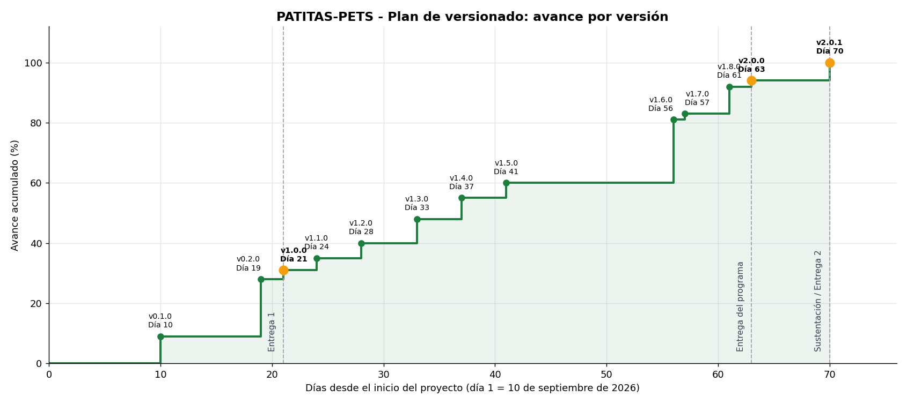

# Plan de versionado — PATITAS-PETS

**Proyecto:** PATITAS-PETS · Gestor de PQRS de MEPEGA
**Equipo:** Anuar Ferney Caldón Quira (líder), Santiago Domínguez Padilla y Sandra Yulieth Salcedo Salazar

---

## 1. Propósito

Este plan describe las versiones del software y el avance logrado cada vez que se completa un procedimiento relevante, contado en **días desde el inicio del proyecto** (día 1 = 10 de septiembre de 2026) hasta la entrega final (día 70 = 18 de noviembre de 2026). Las fechas siguen el [plan de proyecto](03_plan_proyecto.md) y el diagrama de Gantt.

## 2. Esquema de numeración

PATITAS-PETS usa **versionado semántico**: `MAYOR.MENOR.PARCHE`.

| Parte | Cuándo aumenta | Ejemplo |
|---|---|---|
| **MAYOR** | Se hace una entrega formal al docente. | `1.0.0` Entrega 1 · `2.0.0` programa completo |
| **MENOR** | Se agrega una funcionalidad o un entregable nuevo sin romper lo anterior. | `1.2.0` autenticación y archivos |
| **PARCHE** | Se corrige un error sin agregar funciones. | `2.0.1` correcciones tras la revisión cruzada |

Las versiones `0.x.x` corresponden al trabajo previo a la primera entrega.

## 3. Cómo se registra una versión

1. Se actualiza la constante `VERSION` en `src/config.py`; el número aparece en el encabezado de todas las pantallas del programa.
2. Se hace el *commit* con un mensaje que empiece por la versión, por ejemplo: `v1.2.0 - Autenticación y archivos`.
3. Se crea una etiqueta (*tag*) en Git y se publica en GitHub:
   ```bash
   git tag -a v1.2.0 -m "Autenticación y archivos"
   git push origin v1.2.0
   ```
4. Para las versiones MAYOR se crea además un *Release* en GitHub (pestaña **Releases → Draft a new release**) con el resumen de cambios.
5. Se completa la columna **Fecha real** de la tabla de la sección 4 con la fecha en que la versión se publicó de verdad.

## 4. Versiones y avance

El **avance acumulado** es el porcentaje de los 141 días-actividad del cronograma (suma de las duraciones de las 45 actividades) que corresponde a actividades terminadas en la fecha de la versión.

| Versión | Día | Fecha planeada | Fecha real | Avance acumulado | Contenido | Hito |
|---|---:|---|---|---:|---|---|
| **v0.1.0** | 10 | 19-sep-2026 | | 9 % | Análisis terminado y actas firmadas; repositorio creado con src, docs, images y data, y bases de datos origen cargadas. |  |
| **v0.2.0** | 19 | 28-sep-2026 | | 28 % | Documentación de la Entrega 1: README, reporte de visión, requisitos, plan de proyecto, logo y diagramas. |  |
| **v1.0.0** | 21 | 30-sep-2026 | | 31 % | Entrega 1 publicada en GitHub (puntos 1 a 7). | Entrega 1 |
| **v1.1.0** | 24 | 03-oct-2026 | | 35 % | Diseño: flujo general, módulos y funciones, validaciones, estructura de archivos, login, radicados y estadísticas (config.py). |  |
| **v1.2.0** | 28 | 07-oct-2026 | | 40 % | autenticacion.py (login, intentos, bloqueo y sesión) y archivos.py (lectura, escritura y consecutivos por archivo). |  |
| **v1.3.0** | 33 | 12-oct-2026 | | 48 % | registro.py, consultas.py y cambios.py (registro, consulta y actualización de estados con Historial.txt). |  |
| **v1.4.0** | 37 | 16-oct-2026 | | 55 % | validaciones.py completo y radicado.py (comprobante de 120 caracteres). |  |
| **v1.5.0** | 41 | 20-oct-2026 | | 60 % | reportes.py: promedio de días de respuesta, estadísticas y exportación TXT y CSV. |  |
| **v1.6.0** | 56 | 04-nov-2026 | | 81 % | Tablero de Power BI de tres páginas. |  |
| **v1.7.0** | 57 | 05-nov-2026 | | 83 % | Pruebas integrales terminadas y errores corregidos. |  |
| **v1.8.0** | 61 | 09-nov-2026 | | 92 % | Documentación del desarrollo, plan de versionado y manual de usuario. |  |
| **v2.0.0** | 63 | 11-nov-2026 | | 94 % | Programa completo entregado al docente, una semana antes de la sustentación. | Entrega del programa |
| **v2.0.1** | 70 | 18-nov-2026 | | 100 % | Correcciones menores detectadas en la revisión cruzada, si se requieren. | Sustentación / Entrega 2 |



> Las fechas planeadas siguen el cronograma. Si una funcionalidad se publica antes o después de lo planeado, se registra la fecha real en que se publicó.

## 5. Detalle de las versiones principales

### v1.0.0 — Entrega 1 (día 21, 30 de septiembre)

- Actas de entendimiento, colaboración y responsabilidad.
- README con integrantes, vínculos académicos, nombre, logo y licencia (puntos 1 a 4).
- Reporte de visión, especificación de requisitos y plan de proyecto con diagrama de Gantt y presupuesto (puntos 5 a 7).
- Repositorio organizado en `src/`, `docs/`, `images/` y `data/`, con las bases de datos de MEPEGA.

### v2.0.0 — Entrega del programa completo (día 63, 11 de noviembre)

- `autenticacion.py`: ingreso con usuario o correo, máximo tres intentos, bloqueo temporal visible y sesión activa.
- `registro.py` y `validaciones.py`: registro de PQRS con todas las validaciones del enunciado.
- `archivos.py`: cuatro archivos planos independientes con consecutivo propio que continúa desde el 3001.
- `radicado.py`: comprobante de 120 caracteres con marco ASCII.
- `consultas.py`: consulta por radicado, por documento, estado general, activas, más antiguas, próximas a vencer y vencidas.
- `cambios.py`: flujo Registrada → En proceso → Solucionada, con historial en `data/Historial.txt`.
- `reportes.py`: promedio de días de respuesta, cinco estadísticas adicionales y exportación TXT y CSV para Power BI.
- Tablero de Power BI, plan de versionado, documentación del algoritmo y manual de usuario.

### v2.0.1 — Sustentación (día 70, 18 de noviembre)

Reservada para correcciones menores detectadas en la revisión cruzada del código. Si no se detectan errores, la versión final sigue siendo la 2.0.0.
