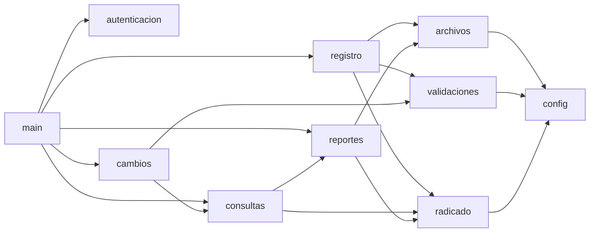
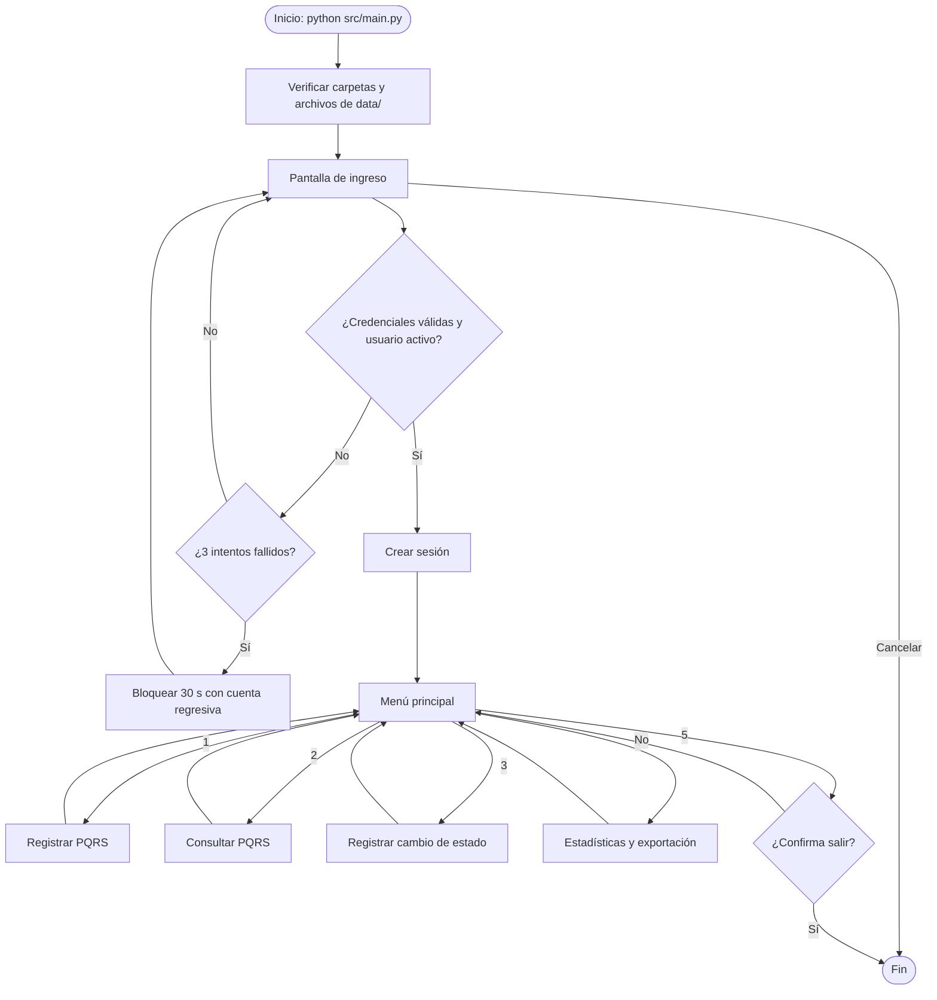
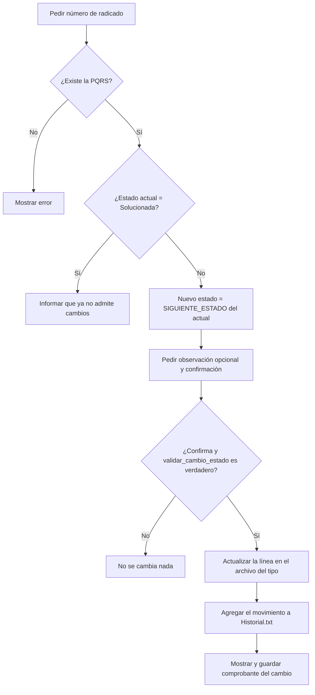

# Algoritmo — PATITAS-PETS

**Proyecto:** PATITAS-PETS · Gestor de PQRS de MEPEGA
**Versión del software:** 2.0.0

Todo el código del proyecto está en la carpeta [`src/`](../src). Este documento explica cómo está organizado, qué hace cada módulo y cómo funcionan los algoritmos principales. Está pensado también como guía de estudio para la sustentación.

---

## 1. Organización del código

| Módulo | Líneas | Responsabilidad | Funciones principales |
|---|---:|---|---|
| `main.py` | 107 | Punto de entrada, menú principal y menú de estadísticas | `main`, `menu_principal`, `menu_estadisticas` |
| `config.py` | 174 | Rutas, catálogos, estructura de datos y reglas de negocio | *(solo constantes)* |
| `interfaz.py` | 131 | Banner, encabezados, lectura de opciones, tablas paginadas y lectura de la clave | `mostrar_encabezado`, `pedir_opcion`, `mostrar_tabla`, `leer_clave` |
| `autenticacion.py` | 120 | Usuarios autorizados, credenciales, intentos, bloqueo y sesión | `iniciar_sesion`, `validar_credenciales`, `bloquear_pantalla` |
| `validaciones.py` | 243 | Reglas de cada campo (nombre, documento, teléfono, correo, fechas, estado…) | `validar_nombre`, `validar_correo`, `validar_fecha_radicacion`, `validar_cambio_estado` |
| `registro.py` | 181 | Opción 1: captura guiada y guardado de una PQRS | `registrar_pqrs`, `capturar_datos`, `pedir_texto`, `elegir` |
| `consultas.py` | 182 | Opción 2: consultas y listados | `menu_consultas`, `buscar_por_radicado`, `ver_listado` |
| `cambios.py` | 90 | Opción 3: cambio de estado | `registrar_cambio` |
| `reportes.py` | 325 | Opción 4: estadísticas y archivos para Power BI | `calcular_estadisticas`, `texto_reporte`, `base_consolidada` |
| `archivos.py` | 225 | Lectura y escritura de todos los archivos planos | `leer_registros`, `siguiente_id`, `guardar_registro`, `actualizar_registro` |
| `radicado.py` | 141 | Comprobante de 120 columnas | `construir_radicado`, `numero_radicado` |
| **Total** | **1.919** | | |

El programa usa únicamente la biblioteca estándar de Python: `pathlib`, `datetime`, `re`, `csv`, `collections`, `textwrap`, `unicodedata`, `getpass`, `time` y `os`.

### Dependencias entre módulos



Todos los módulos leen sus parámetros de `config.py` y usan `interfaz.py` para la pantalla (flechas omitidas para no recargar el diagrama).

## 2. Estructuras de datos

| Estructura | Tipo en Python | Ejemplo |
|---|---|---|
| Una PQRS | Diccionario con 18 claves (`config.CAMPOS`) | `{"id": "3001", "nombre_completo": "Laura Gómez Ruiz", ..., "estado_peticion": "Registrada"}` |
| Un archivo de PQRS en memoria | Lista de diccionarios | `archivos.leer_registros("Queja")` |
| Sesión activa | Diccionario sin la clave | `{"usuario": "admin_udea", "nombre": "...", "rol": "Administrador", "inicio": "..."}` |
| Cambio de estado | Diccionario con 7 claves (`config.CAMPOS_HISTORIAL`) | `{"tipo_solicitud": "Peticion", "id": "3001", "estado_anterior": "Registrada", ...}` |
| Catálogos | Listas y diccionarios en `config.py` | `TIPOS_MASCOTA = ["Perro", "Gato", "Otro"]` |
| Flujo de estados | Diccionario estado → siguiente estado | `{"Registrada": "En proceso", "En proceso": "Solucionada"}` |
| Resultado de una validación | Tupla `(bool, str)` | `(False, "El nombre no puede contener números.")` |

En los archivos planos cada PQRS es una línea con los 18 valores separados por `|`. Al leer, `split("|")` convierte la línea en lista y `dict(zip(encabezado, valores))` la convierte en diccionario; al escribir, `"|".join(...)` hace lo contrario.

## 3. Flujo general del programa



## 4. Algoritmos principales

### 4.1 Autenticación con control de intentos (`autenticacion.iniciar_sesion`)

```
usuarios <- leer Usuarios.txt
intentos_fallidos <- 0
REPETIR
    pedir identificador (usuario o correo) y clave
    SI el usuario elige CANCELAR ENTONCES retornar nada
    buscar usuario cuyo nombre de usuario o correo coincida (sin importar mayúsculas)
    SI existe, la clave coincide y el estado es "Activo" ENTONCES
        retornar sesión con usuario, nombre, correo, rol y hora de ingreso
    intentos_fallidos <- intentos_fallidos + 1
    SI intentos_fallidos = 3 ENTONCES
        mostrar cuenta regresiva de 30 a 1 segundos
        intentos_fallidos <- 0
```

El mensaje de error es el mismo si falla el usuario o la clave, para no darle pistas a un intruso.

### 4.2 Captura validada de un campo (`registro.pedir_texto`)

Todos los campos de texto usan el mismo patrón: **pedir hasta que sea válido**.

```
REPETIR
    valor <- leer texto y quitar espacios repetidos
    SI valor = "cancelar" ENTONCES lanzar RegistroCancelado
    (es_valido, mensaje) <- funcion_de_validacion(valor)
    SI es_valido ENTONCES retornar valor
    mostrar mensaje
```

La función de validación se recibe como parámetro, por eso la misma función `pedir_texto` sirve para el nombre, el documento, el teléfono, el correo, la dirección, el asunto y la descripción. Los campos de lista cerrada usan `elegir`, que muestra un menú numerado y solo acepta números del rango.

### 4.3 Consecutivo independiente por archivo (`archivos.siguiente_id`)

```
ids <- [entero(id) de cada registro del archivo del tipo]
retornar máximo(ids) + 1        (1 si el archivo está vacío)
```

Con las bases entregadas el máximo de cada archivo es 3000, así que el primer registro nuevo de cada tipo recibe el **3001**. El cálculo se hace justo antes de escribir (`guardar_registro`), de modo que el número siempre es el siguiente al último guardado, aunque el archivo haya cambiado mientras se capturaban los datos.

### 4.4 Radicado de 120 columnas (`radicado.construir_radicado`)

```
INTERIOR <- 120 - 4                        (espacio entre "| " y " |")
borde            <- "+" + "-" * 118 + "+"
línea de texto   <- "| " + texto.ljust(INTERIOR) + " |"
línea centrada   <- "| " + texto.center(INTERIOR) + " |"
campo            <- "Etiqueta ......: " + valor
    SI el valor no cabe, textwrap lo parte en varias líneas alineadas
al final: verificar que TODAS las líneas midan exactamente 120; si no, error
```

La descripción detallada nunca se incluye y la dirección vacía se muestra como `N/A`.

### 4.5 Cambio de estado (`cambios.registrar_cambio`)



**Actualización segura (`archivos.actualizar_registro`).** Se leen todas las líneas del archivo, se reemplaza solo la línea cuyo primer campo es el ID, se escribe todo en un archivo temporal `.tmp` y luego ese archivo reemplaza al original en un solo paso (`Path.replace`). Si el programa se interrumpe a mitad de la escritura, el archivo original no se daña.

### 4.6 Plazos y promedio de días de respuesta (`reportes.py`)

```
clasificar_plazo(pqrs, ahora):
    SI estado = "Solucionada"                          -> "Solucionada"
    restante <- fecha_maxima_respuesta - ahora
    SI restante < 0                                    -> "Vencida"
    SI restante < 5 días (DIAS_ALERTA_VENCIMIENTO)     -> "Próxima a vencer"
    SI NO                                              -> "Al día"

promedio_de_dias_de_respuesta:
    soluciones <- {(tipo, id): fecha} de los cambios a "Solucionada" en Historial.txt
    días <- [fecha_solucion - fecha_radicacion] de cada PQRS solucionada que tenga fecha
    SI días no está vacía -> redondear(suma(días) / cantidad(días))
    SI NO                 -> "sin datos"
```

Las bases de MEPEGA no tienen fecha de solución, por eso las PQRS que ya venían solucionadas no entran en el promedio; el reporte informa cuántas quedan por fuera y muestra como referencia el plazo promedio otorgado y la antigüedad promedio de las PQRS activas.

### 4.7 Perfil del solicitante (`reportes.perfil_solicitante`)

Las bases no tienen un campo de perfil, así que la estadística 6 lo deriva de dos datos que sí existen:

```
SI tipo_documento = "NIT"                         -> "Organización (NIT)"
SI el dominio del correo es "udea.edu.co"          -> "Comunidad UdeA"
SI NO                                             -> "Ciudadano externo"
```

El orden importa: una organización con correo institucional se cuenta como organización. La regla está en una sola función y el dominio en `config.DOMINIO_INSTITUCIONAL`, de modo que si el PO aprueba un campo de perfil, solo cambia esa función.

## 5. Archivos que usa el programa

| Archivo | Lectura | Escritura | Módulo |
|---|---|---|---|
| `data/Usuarios.txt` | Ingreso y nombre del registrador | — | `autenticacion.py` |
| `data/Peticion.txt`, `Queja.txt`, `Reclamo.txt`, `Sugerencia.txt` | Consultas y estadísticas | Registro (agrega al final) y cambio de estado (reemplaza la línea) | `archivos.py` |
| `data/Historial.txt` | Radicado de consulta y promedio de respuesta | Cada cambio de estado | `archivos.py` |
| `data/radicados/*.txt` | — | Radicado de registro y comprobante de cada cambio | `archivos.py`, `radicado.py` |
| `data/exportaciones/reporte_estadisticas_*.txt` | — | Opción 4.2 | `reportes.py` |
| `data/exportaciones/base_consolidada_pqrs.csv` | — | Opción 4.3 (fuente de Power BI) | `reportes.py` |

## 6. Pruebas realizadas

| # | Caso de prueba | Resultado esperado | Resultado |
|---|---|---|---|
| 1 | Ejemplos válidos e inválidos del enunciado (`python src/validaciones.py`) | 20 de 20 pruebas correctas | ✅ |
| 2 | 3 intentos fallidos de ingreso | Bloqueo con cuenta regresiva y nuevo intento habilitado | ✅ |
| 3 | Ingreso con el correo en mayúsculas | Ingreso exitoso | ✅ |
| 4 | Registro de la primera Petición nueva | ID 3001; los 3.000 registros originales intactos | ✅ |
| 5 | Datos inválidos durante el registro (teléfono con letras, fecha futura, descripción corta, carácter `\|`) | Mensaje de error y nueva solicitud del dato | ✅ |
| 6 | Escribir `cancelar` a mitad del registro | No se guarda nada | ✅ |
| 7 | Radicado con textos muy largos y modo ASCII | Todas las líneas miden 120 caracteres | ✅ |
| 8 | Registrada → En proceso → Solucionada | Cambios aplicados, 2 líneas en Historial.txt y 2 comprobantes | ✅ |
| 9 | Intentar cambiar una PQRS solucionada | Mensaje "no admite más cambios" | ✅ |
| 10 | Archivo de datos sin salto de línea final | El nuevo registro queda en su propia línea | ✅ |
| 11 | Archivo de datos inexistente | Se crea con encabezado y el consecutivo inicia en 1 | ✅ |
| 12 | Estadísticas y base para Power BI con 12.001 registros | Cálculo en menos de 1 segundo; CSV de 12.001 filas y 20 columnas | ✅ |
| 13 | Valores del reporte frente a un cálculo independiente con pandas sobre el CSV exportado | Todas las cifras coinciden (`docs/powerbi/valores_control.md`) | ✅ |

## 7. Preguntas de repaso para la sustentación

Cada integrante debe poder responder cualquiera de estas preguntas y señalar la línea de código correspondiente.

1. ¿Por qué el ID se calcula con `max(ids) + 1` y no contando las líneas del archivo? *(archivos.py, `siguiente_id`)*
2. ¿Qué pasa si alguien escribe `|` en la descripción y por qué se impide? *(validaciones.py, `validar_descripcion`)*
3. ¿Cómo se garantiza que cada línea del radicado mida exactamente 120 caracteres? *(radicado.py)*
4. ¿Qué devuelven las funciones de validación y por qué se eligió una tupla? *(validaciones.py)*
5. ¿Cómo funciona el bloqueo tras 3 intentos y dónde se cambia su duración? *(autenticacion.py y config.py)*
6. ¿Por qué `actualizar_registro` escribe primero un archivo `.tmp`? *(archivos.py)*
7. ¿Cómo impide el programa pasar de Registrada a Solucionada directamente? *(config.SIGUIENTE_ESTADO y validaciones.py)*
8. ¿De dónde sale la fecha de solución para el promedio de días de respuesta? *(reportes.py, `fechas_de_solucion`)*
9. ¿Cuándo una PQRS se considera "próxima a vencer"? *(reportes.py, `clasificar_plazo`)*
10. ¿Qué hace `dict(zip(encabezado, valores))`? *(archivos.py, `leer_archivo_plano`)*
11. ¿Por qué el programa funciona aunque se ejecute desde otra carpeta? *(config.py, `RAIZ_PROYECTO`)*
12. ¿Por qué la base para Power BI no incluye nombres, teléfonos ni correos? *(reportes.py, `base_consolidada`)*
13. ¿Cómo se obtiene el perfil del solicitante si las bases no tienen ese campo? *(reportes.py, `perfil_solicitante`)*
