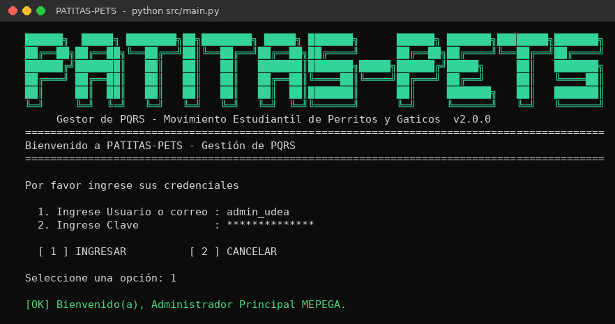
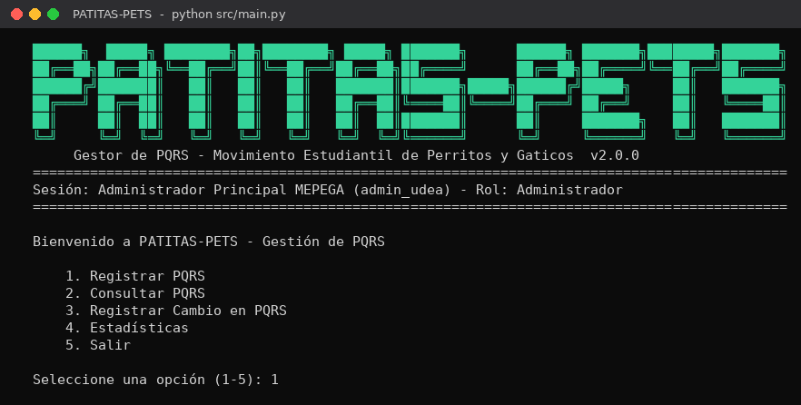
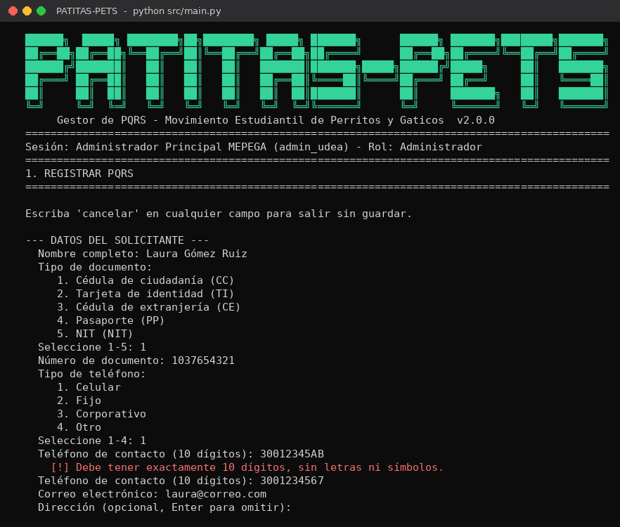
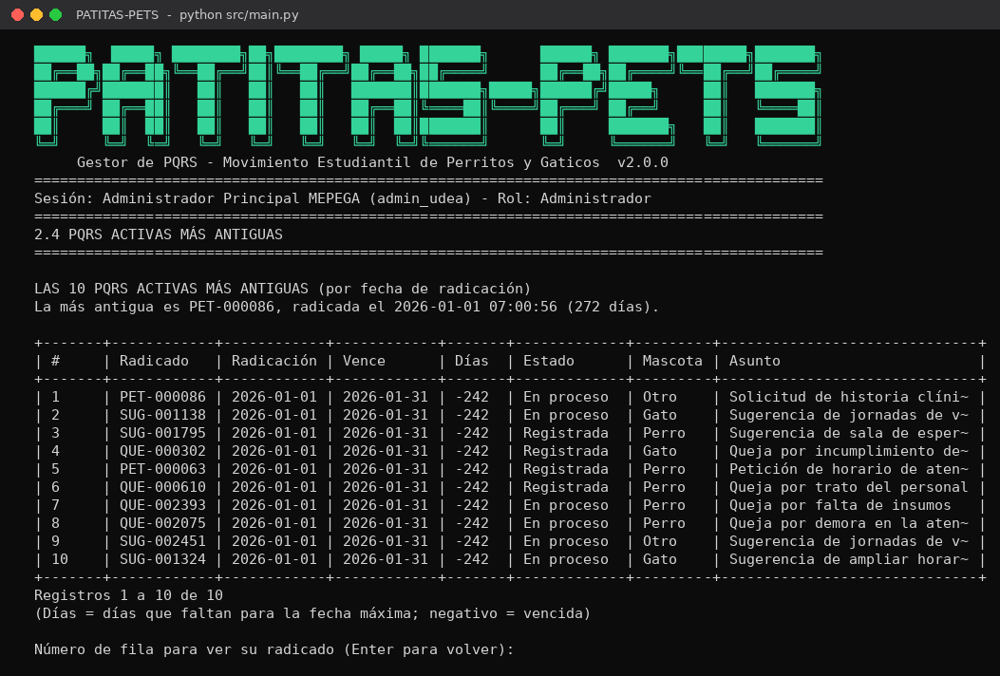
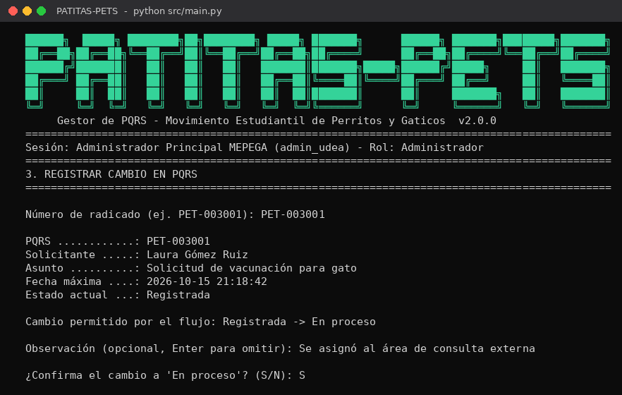
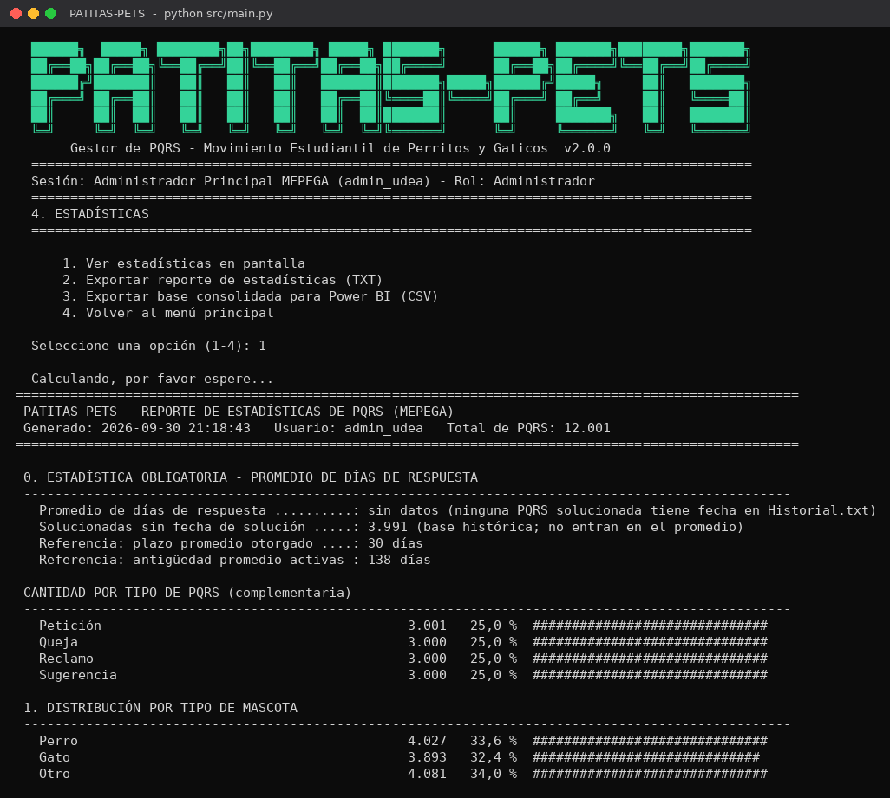

# Manual de usuario — PATITAS-PETS

**Gestor de PQRS de MEPEGA · Versión 2.0.0**

Este manual explica paso a paso cómo instalar y usar PATITAS-PETS para registrar, consultar, actualizar y analizar las peticiones, quejas, reclamos y sugerencias (PQRS) de MEPEGA.

---

## Contenido

1. [Requisitos](#1-requisitos)
2. [Instalación y ejecución](#2-instalación-y-ejecución)
3. [Conceptos básicos](#3-conceptos-básicos)
4. [Ingreso al sistema](#4-ingreso-al-sistema)
5. [Menú principal](#5-menú-principal)
6. [Registrar PQRS](#6-registrar-pqrs)
7. [Consultar PQRS](#7-consultar-pqrs)
8. [Registrar cambio en PQRS](#8-registrar-cambio-en-pqrs)
9. [Estadísticas](#9-estadísticas)
10. [Archivos que genera el programa](#10-archivos-que-genera-el-programa)
11. [Configuración para el administrador](#11-configuración-para-el-administrador)
12. [Solución de problemas](#12-solución-de-problemas)
13. [Glosario](#13-glosario)

---

## 1. Requisitos

| Elemento | Requisito |
|---|---|
| Sistema operativo | Windows 10/11, macOS o Linux |
| Python | Versión 3.10 o superior ([descarga](https://www.python.org/downloads/)). En Windows, marque la casilla **Add Python to PATH** durante la instalación. |
| Librerías adicionales | Ninguna |
| Pantalla | Consola de al menos 120 columnas de ancho para ver el radicado completo |
| Usuario | Un usuario **activo** registrado en `data/Usuarios.txt` |

## 2. Instalación y ejecución

1. Descargue el repositorio desde GitHub: botón verde **Code → Download ZIP**, y descomprímalo. También puede clonarlo con `git clone`.
2. Abra una terminal en la carpeta del proyecto (la que contiene `README.md`, `src/` y `data/`):
   - **Windows:** abra la carpeta en el Explorador, escriba `cmd` en la barra de direcciones y presione Enter.
   - **macOS / Linux:** abra la Terminal y use `cd` hasta la carpeta del proyecto.
   - **Visual Studio Code:** menú **Archivo → Abrir carpeta** y luego **Terminal → Nueva terminal**.
3. Ejecute el programa:

   ```bash
   python src/main.py
   ```

   En macOS y Linux puede ser necesario escribir `python3` en lugar de `python`.

> **Consejo:** maximice la ventana de la consola antes de empezar, para que el radicado de 120 columnas se vea completo.

## 3. Conceptos básicos

**Tipos de PQRS.** Cada tipo se guarda en su propio archivo y tiene su propia numeración:

| Tipo | Archivo | Prefijo del radicado |
|---|---|---|
| Petición | `data/Peticion.txt` | `PET` |
| Queja | `data/Queja.txt` | `QUE` |
| Reclamo | `data/Reclamo.txt` | `REC` |
| Sugerencia | `data/Sugerencia.txt` | `SUG` |

**Número de radicado.** Prefijo + ID de 6 dígitos. Ejemplo: `PET-003001` es la Petición con ID 3001. Con este número se consulta y se actualiza cualquier PQRS.

**Estados.** Toda PQRS inicia en **Registrada** y solo puede avanzar un paso a la vez:

```
Registrada  ──►  En proceso  ──►  Solucionada
```

No se permiten saltos (de Registrada a Solucionada) ni retrocesos. Una PQRS solucionada queda cerrada.

**Plazo de respuesta.** La fecha máxima de respuesta es la fecha de radicación + **15 días calendario**. Una PQRS activa está **próxima a vencer** si le quedan menos de **5 días**, y **vencida** si ya pasó su fecha máxima sin solucionarse.

## 4. Ingreso al sistema



1. En **Ingrese Usuario o correo**, escriba su nombre de usuario (por ejemplo, `admin_udea`) o su correo institucional. No importa si usa mayúsculas o minúsculas.
2. En **Ingrese Clave**, escriba su clave. En Windows se muestra un `*` por cada carácter; en macOS y Linux no se muestra nada mientras escribe (es normal).
3. Digite **1** para **INGRESAR** o **2** para **CANCELAR** y salir del programa.

**Intentos fallidos.** Tiene 3 intentos. Al tercer error la pantalla se bloquea durante 30 segundos y se muestra la cuenta regresiva; al terminar puede intentarlo de nuevo. Solo pueden ingresar usuarios con estado **Activo**.

Al ingresar, su nombre, usuario y rol aparecen en el encabezado de todas las pantallas. Todas las PQRS y todos los cambios que usted registre quedan a su nombre.

## 5. Menú principal



| Opción | Para qué sirve |
|---|---|
| **1. Registrar PQRS** | Radicar una nueva petición, queja, reclamo o sugerencia |
| **2. Consultar PQRS** | Buscar una PQRS, ver el estado general y los listados de seguimiento |
| **3. Registrar Cambio en PQRS** | Avanzar el estado de una PQRS |
| **4. Estadísticas** | Ver y exportar las estadísticas y la base para Power BI |
| **5. Salir** | Cerrar la sesión (el programa pide confirmación) |

Digite el número de la opción y presione Enter. Si digita algo diferente, el programa se lo vuelve a pedir.

## 6. Registrar PQRS



El programa pide los datos en tres bloques. Si un dato no cumple las reglas, aparece un mensaje en rojo que explica el problema y el dato se vuelve a pedir; lo que ya digitó no se pierde.

> Para salir sin guardar, escriba **`cancelar`** en cualquier campo.

**Datos del solicitante**

| Campo | Obligatorio | Cómo diligenciarlo | Ejemplo |
|---|---|---|---|
| Nombre completo | Sí | 3 a 100 caracteres; solo letras (con tildes y ñ), espacios, `'` y `-` | Juan David Pérez Gómez |
| Tipo de documento | Sí | Elija el número de la lista (CC, TI, CE, PP o NIT) | 1 |
| Número de documento | Sí | Solo números, de 3 a 15 dígitos | 1037654321 |
| Tipo de teléfono | Sí | Elija de la lista (Celular, Fijo, Corporativo u Otro) | 1 |
| Teléfono de contacto | Sí | Exactamente 10 dígitos | 3001234567 |
| Correo electrónico | Sí | Formato `usuario@dominio.com`, con una sola `@` | usuario@correo.com |
| Dirección | No | Presione Enter para omitirla. Si la escribe: 5 a 200 caracteres; se permiten `# - . , /` | Carrera 55 #8-73 |

**Información de la PQRS**

| Campo | Obligatorio | Cómo diligenciarlo | Ejemplo |
|---|---|---|---|
| Tipo de solicitud | Sí | Elija Petición, Queja, Reclamo o Sugerencia | 1 |
| Fecha de radicación | Sí | Presione Enter para usar la fecha y hora actual, o escriba `AAAA-MM-DD HH:MM` si la PQRS llegó antes (por ejemplo, en papel). No se aceptan fechas futuras. | 2026-09-27 10:15 |
| Canal de recepción | Sí | Elija de la lista | 3 |
| Asunto o título | Sí | 5 a 150 caracteres | Solicitud de cita para esterilización |
| Descripción detallada | Sí | 20 a 2.000 caracteres; no use el carácter `\|` | Solicito información sobre… |

**Información relacionada:** tipo de mascota (Perro, Gato u Otro) y campus relacionado, ambos de una lista.

**Confirmación y radicado.** Al terminar, el programa muestra un resumen y pregunta **¿Desea guardar esta PQRS? (S/N)**. Con **S**:

- La PQRS se guarda en el archivo de su tipo con el siguiente ID disponible.
- Queda en estado **Registrada**, con su fecha máxima de respuesta y su nombre como registrador.
- Se muestra el radicado y se guarda en `data/radicados/`, por ejemplo `data/radicados/PET-003001.txt`. Entregue ese número al solicitante.

Vea un radicado completo en [ejemplo_radicado.txt](ejemplo_radicado.txt).

## 7. Consultar PQRS

El submenú ofrece cinco consultas. Los listados se muestran en tablas de 15 filas: presione **Enter** para la siguiente página o **S** para terminar. Al final de cada listado puede escribir el **número de fila** (columna `#`) para ver esa PQRS completa con el formato del radicado.



| Opción | Qué muestra |
|---|---|
| **1. Consultar PQRS por número de radicado** | La PQRS con el formato del radicado, incluido su **historial de estados** (quién la cambió, cuándo y con qué observación). Acepta `PET-003001`, `pet-3001` o `PET 3001`. |
| **2. Buscar PQRS por documento del solicitante** | Todas las PQRS de una persona, en los cuatro archivos. Útil cuando el solicitante no recuerda su número de radicado. |
| **3. Estado general y registros activos** | Tabla con la cantidad de PQRS por tipo y estado. Luego puede listar las PQRS activas (Registradas o En proceso) de un tipo, ordenadas de la más urgente a la menos urgente. |
| **4. PQRS activas más antiguas** | Las 10 PQRS activas con la fecha de radicación más antigua. |
| **5. PQRS próximas a vencer y vencidas** | La cantidad de PQRS a las que les quedan menos de 5 días y de las ya vencidas, con la opción de listar cada grupo. |

La columna **Días** indica cuántos días faltan para la fecha máxima; un número negativo significa que la PQRS está vencida.

## 8. Registrar cambio en PQRS



1. Escriba el número de radicado.
2. El programa muestra el solicitante, el asunto, la fecha máxima y el **estado actual**, y le indica el **único cambio permitido** por el flujo.
3. Escriba una observación si lo desea (máximo 300 caracteres), por ejemplo, a qué área se asignó o qué respuesta se dio. Presione Enter para omitirla.
4. Confirme con **S**.

El programa actualiza la PQRS, registra el cambio en `data/Historial.txt` y genera un comprobante en `data/radicados/` (por ejemplo, `PET-003001_En-proceso.txt`). Si la PQRS ya está **Solucionada**, el programa informa que no admite más cambios.

> **Importante:** la fecha en que una PQRS pasa a **Solucionada** es la que se usa para calcular el promedio de días de respuesta. Registre cada solución en el momento en que se da.

## 9. Estadísticas



| Opción | Resultado |
|---|---|
| **1. Ver estadísticas en pantalla** | Reporte completo en la consola |
| **2. Exportar reporte de estadísticas (TXT)** | El mismo reporte en `data/exportaciones/reporte_estadisticas_AAAAMMDD_HHMMSS.txt` |
| **3. Exportar base consolidada para Power BI (CSV)** | Las cuatro bases unidas, con columnas calculadas, en `data/exportaciones/base_consolidada_pqrs.csv` |

**Contenido del reporte**

| # | Estadística | Qué mide |
|---|---|---|
| 0 | **Promedio de días de respuesta** (obligatoria) | Días entre la radicación y la solución, redondeados al entero. Solo incluye PQRS solucionadas en PATITAS-PETS, porque las bases históricas no tienen fecha de solución; el reporte indica cuántas quedan por fuera. |
| 1 | Distribución por tipo de mascota | Cantidad y porcentaje de PQRS para perros, gatos y otros |
| 2 | Proporción por canal de recepción | Porcentaje de PQRS por cada canal |
| 3 | Distribución por campus | Dónde se concentra la demanda |
| 4 | Efectividad por estado | Porcentaje de PQRS Registradas, En proceso y Solucionadas, y tasa de resolución |
| 5 | Alerta de vencimiento | De las PQRS activas: cuántas están vencidas, próximas a vencer y al día |
| 6 | Perfil del solicitante y carga operativa | Perfil derivado (Comunidad UdeA, Ciudadano externo u Organización), y PQRS registradas por rol y por usuario |
| — | Complementarias | Cantidad por tipo de PQRS y por tipo de documento del solicitante |

La base para Power BI **no incluye** nombres, documentos, teléfonos, correos, direcciones ni descripciones, para proteger los datos personales de los solicitantes. La construcción del tablero se explica en la [guía de Power BI](08_guia_power_bi.md).

## 10. Archivos que genera el programa

| Ubicación | Contenido | ¿Se puede borrar? |
|---|---|---|
| `data/Peticion.txt`, `Queja.txt`, `Reclamo.txt`, `Sugerencia.txt` | Bases de datos de PQRS | **No.** Son la información del sistema. |
| `data/Historial.txt` | Todos los cambios de estado | **No.** Sin él se pierde el cálculo del promedio de respuesta. |
| `data/radicados/` | Radicados y comprobantes de cambio | Sí, se pueden archivar; no afectan los datos. |
| `data/exportaciones/` | Reportes y base para Power BI | Sí, se regeneran desde el menú de estadísticas. |

> **No edite los archivos de `data/` a mano** con Excel o el Bloc de notas: un separador `|` de más o de menos daña el registro. Si una línea está dañada, el programa la omite y muestra un aviso con el número de línea. Haga una copia de la carpeta `data/` antes de cualquier cambio masivo.

## 11. Configuración para el administrador

Los parámetros se cambian en `src/config.py`, sin tocar el resto del código:

| Parámetro | Valor actual | Qué controla |
|---|---|---|
| `PLAZO_RESPUESTA_DIAS` | 15 | Días calendario para responder una PQRS |
| `DIAS_ALERTA_VENCIMIENTO` | 5 | Días antes del vencimiento en que una PQRS pasa a "próxima a vencer" |
| `MAX_INTENTOS_LOGIN` | 3 | Intentos fallidos antes del bloqueo |
| `SEGUNDOS_BLOQUEO` | 30 | Duración del bloqueo de la pantalla de ingreso |
| `FILAS_POR_PAGINA` | 15 | Filas por página en los listados |
| `RADICADO_SOLO_ASCII` | False | Con `True`, el radicado se genera sin tildes ni ñ |
| `MOSTRAR_ASTERISCOS` | True | Con `False`, la clave se lee oculta sin mostrar `*` |

Los usuarios autorizados se administran en `data/Usuarios.txt` (una línea por usuario: `usuario|nombre_completo|correo_institucional|contrasena|rol|estado`). Para desactivar a alguien sin borrarlo, cambie su estado a `Inactivo`.

## 12. Solución de problemas

| Situación | Causa probable | Solución |
|---|---|---|
| `python` no se reconoce como comando | Python no está instalado o no está en el PATH | Reinstale Python marcando **Add Python to PATH**, o use `py src/main.py` en Windows |
| `[ERROR] No se encontró ...Usuarios.txt` | Falta la carpeta `data/` o el archivo de usuarios | Verifique que exista `data/Usuarios.txt` dentro de la carpeta del proyecto |
| "Usuario o clave incorrectos" | Error de digitación o usuario inactivo | Revise mayúsculas de la clave; confirme el estado en `Usuarios.txt` |
| No aparecen los `*` al escribir la clave o la clave no responde | La consola del editor no permite leer tecla por tecla | Ejecute el programa en `cmd`/PowerShell, o cambie `MOSTRAR_ASTERISCOS = False` |
| El banner o las tildes se ven como símbolos extraños | La consola no usa UTF-8 | Use Windows Terminal o PowerShell; en `cmd` ejecute `chcp 65001` antes del programa |
| El radicado se ve partido | La ventana tiene menos de 120 columnas | Maximice la consola o abra el archivo de `data/radicados/` |
| "Cambio no permitido" | Se intentó saltar o retroceder un estado | Siga el flujo Registrada → En proceso → Solucionada |
| "[Aviso] ... línea N ... Se omite" | Una línea del archivo fue editada a mano y quedó con campos de más o de menos | Corrija esa línea con cuidado o restaure la copia de seguridad |
| "No se pudo escribir en ...: el archivo está abierto en otro programa" | Un archivo de `data/` está abierto en Excel u otro programa | Cierre ese archivo y repita la operación; no se guardó nada |
| El promedio de días de respuesta dice "sin datos" | Aún no se ha solucionado ninguna PQRS desde PATITAS-PETS | Registre las soluciones con la opción 3 del menú |

## 13. Glosario

| Término | Significado |
|---|---|
| **PQRS** | Petición, Queja, Reclamo o Sugerencia |
| **Radicado** | Número único que identifica una PQRS y comprobante que certifica su registro |
| **Radicar** | Registrar formalmente una PQRS y asignarle su número |
| **PQRS activa** | PQRS en estado Registrada o En proceso |
| **Fecha máxima de respuesta** | Límite para dar respuesta: fecha de radicación + 15 días |
| **Historial** | Registro de todos los cambios de estado de una PQRS |
| **Registrador** | Usuario que tenía la sesión abierta cuando se registró la PQRS |
