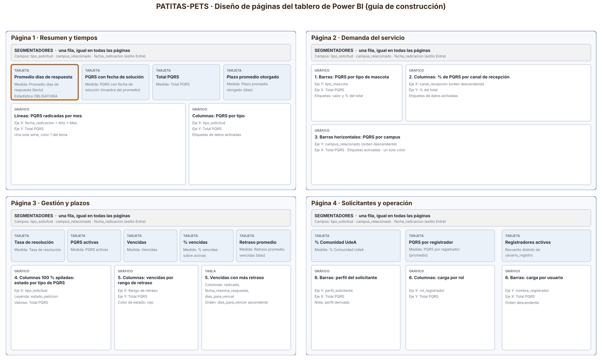

# Guía de Power BI — Tablero de PATITAS-PETS

**Responsable:** Sandra Yulieth Salcedo Salazar (gestión de datos y Power BI) · **Herramienta:** Power BI Desktop (gratuito, Windows)

El tablero se arma en Power BI Desktop en unos 45 minutos con el kit de la carpeta [`docs/powerbi/`](powerbi). La consulta de datos, las medidas, el tema de colores y el diseño de cada página ya están definidos. Solo falta crear los visuales y comprobar las cifras.

---

## Kit de construcción

| Archivo | Para qué sirve |
|---|---|
| [`tema_patitas_pets.json`](powerbi/tema_patitas_pets.json) | Colores del tablero, tomados del logo y validados para daltonismo |
| [`consulta_power_query.pq`](powerbi/consulta_power_query.pq) | Carga la base desde GitHub con los tipos de dato correctos |
| [`medidas_dax.dax`](powerbi/medidas_dax.dax) | Todas las medidas y la columna "Rango de retraso" |
| [`valores_control.md`](powerbi/valores_control.md) | Cifras esperadas para comprobar cada medida |
| [`../images/powerbi_diseno_paginas.png`](../images/powerbi_diseno_paginas.png) | Diseño de las 4 páginas: qué visual va en cada lugar y con qué campos |

La fuente de datos es [`data/exportaciones/base_consolidada_pqrs.csv`](../data/exportaciones/base_consolidada_pqrs.csv). PATITAS-PETS la genera en **4. Estadísticas → 3. Exportar base consolidada para Power BI**. Tiene una fila por PQRS (12.000) y 20 columnas, sin datos personales del solicitante (Ley 1581 de 2012).

## Paso 1. Aplicar el tema

1. Abra Power BI Desktop y cree un informe en blanco.
2. **Vista → Temas → Examinar temas** y elija `docs/powerbi/tema_patitas_pets.json`.

## Paso 2. Cargar los datos

1. **Inicio → Obtener datos → Consulta en blanco**.
2. En el Editor de Power Query: **Inicio → Editor avanzado**, borre todo, pegue el contenido de `consulta_power_query.pq` y haga clic en **Listo**.
3. Si Power BI pide credenciales, elija **Anónimo → Conectar**.
4. En el panel derecho, cambie el nombre de la consulta a **PQRS** y haga clic en **Inicio → Cerrar y aplicar**.

La consulta lee el archivo publicado en el repositorio, así que no hay que cambiar rutas. Para trabajar sin internet, el mismo archivo explica cómo apuntar a la copia local.

## Paso 3. Crear las medidas

En la vista de datos, haga clic derecho sobre la tabla **PQRS → Nueva medida** y pegue cada medida de `medidas_dax.dax` una por una. **Rango de retraso** se crea con **Nueva columna**, no con Nueva medida. A las medidas con "%" o "Tasa" en el nombre deles formato **Porcentaje, 1 decimal** (pestaña **Herramientas de medidas**).

## Paso 4. Construir las páginas

Copie la fila de segmentadores de la página 1 y péguela en las demás (al pegar, elija **Sincronizar**). En todos los gráficos active **Etiquetas de datos**: dos colores del tema tienen poco contraste sobre blanco y la etiqueta es la que permite leer el valor.

| Página | Visual | Configuración | Estadística |
|---|---|---|---|
| 1. Resumen y tiempos | 4 tarjetas | *Promedio días de respuesta (texto)*, *PQRS con fecha de solución*, *Total PQRS*, *Plazo promedio otorgado (días)* | **Obligatoria** (primera tarjeta) |
| | Gráfico de líneas | Eje X: `fecha_radicacion` (Año › Mes) · Eje Y: *Total PQRS* | Complementaria |
| | Gráfico de columnas | Eje X: `tipo_solicitud` · Eje Y: *Total PQRS* | Complementaria |
| 2. Demanda del servicio | Gráfico de barras | Eje Y: `tipo_mascota` · Eje X: *Total PQRS* · Información sobre herramientas: *% del total* | 1 |
| | Gráfico de columnas | Eje X: `canal_recepcion` · Eje Y: *% del total* · orden descendente | 2 |
| | Gráfico de barras | Eje Y: `campus_relacionado` · Eje X: *Total PQRS* · orden descendente | 3 |
| 3. Gestión y plazos | 5 tarjetas | *Tasa de resolución*, *PQRS activas*, *Vencidas*, *% vencidas sobre activas*, *Retraso promedio vencidas (días)* | 4 y 5 |
| | Columnas 100 % apiladas | Eje X: `tipo_solicitud` · Leyenda: `estado_peticion` · Valores: *Total PQRS* | 4 |
| | Gráfico de columnas | Eje X: *Rango de retraso* · Eje Y: *Total PQRS* · color de barras `#D03B3B` (estado crítico) | 5 |
| | Tabla | `radicado`, `fecha_maxima_respuesta`, `dias_para_vencer` · filtro `estado_plazo` = Vencida · orden por `dias_para_vencer` ascendente | 5 |
| 4. Solicitantes y operación | 3 tarjetas | *% Comunidad UdeA*, *PQRS por registrador (promedio)*, *Registradores activos* | 6 |
| | Gráfico de barras | Eje Y: `perfil_solicitante` · Eje X: *Total PQRS* | 6 |
| | Gráfico de columnas | Eje X: `rol_registrador` · Eje Y: *Total PQRS* | 6 |
| | Gráfico de barras | Eje Y: `nombre_registrador` · Eje X: *Total PQRS* · orden descendente | 6 |

**Colores.** Los gráficos de una sola serie usan el primer color del tema (azul). En la columna apilada de la página 3 el orden de la leyenda debe ser Registrada, En proceso, Solucionada. Los colores de estado (verde, ámbar, rojo) quedan reservados para los plazos y no se usan para otras series.

## Paso 5. Comprobar las cifras

Sin filtros aplicados, cada tarjeta y cada gráfico debe coincidir con [`valores_control.md`](powerbi/valores_control.md). Por ejemplo: *Total PQRS* = 12.000, *Tasa de resolución* = 33,3 %, *PQRS activas* = 8.009. Si una cifra no coincide, revise el tipo de dato de esa columna en Power Query (Paso 2).

## Paso 6. Guardar y entregar

Guarde el informe como `docs/powerbi/PATITAS-PETS_dashboard.pbix` y expórtelo también en PDF (**Archivo → Exportar → Exportar a PDF**) en la misma carpeta, para que el docente lo vea sin instalar Power BI. Súbalos al repositorio desde su propia cuenta de GitHub.

---

## Notas para la sustentación

**La primera tarjeta dice "Sin datos aún".** El promedio de días de respuesta se calcula con la fecha en que cada PQRS pasa a *Solucionada*, que PATITAS-PETS guarda en `data/Historial.txt`. Las bases de MEPEGA no traen esa fecha, así que las 3.991 PQRS que ya venían solucionadas no tienen fecha de solución y no entran en el promedio. Para que el tablero muestre un valor real:

1. Con la opción **3. Registrar cambio en PQRS**, lleven varias PQRS de *Registrada* a *En proceso* y luego a *Solucionada*.
2. Exporten de nuevo la base (**4. Estadísticas → 3**) y súbanla a GitHub.
3. En Power BI, **Inicio → Actualizar**.

Si el docente entrega las fechas de solución de la base histórica, se cargan en `Historial.txt` y el promedio las incluye sin cambiar el código.

**El 100 % de las PQRS activas está vencido.** La PQRS más reciente de la base se radicó el 28 de septiembre de 2026 y su plazo de 30 días terminó el 28 de octubre. Por eso no hay PQRS "al día" ni "próximas a vencer", y la página 3 muestra cuánto retraso acumula cada una: el promedio es de 145 días.

**El perfil del solicitante es derivado.** El enunciado pide clasificar por Estudiante, Docente, Administrativo o Ciudadano, pero las bases no tienen ese campo. PATITAS-PETS lo deriva así: documento NIT → *Organización (NIT)*; correo `@udea.edu.co` → *Comunidad UdeA*; cualquier otro → *Ciudadano externo*. Separar estudiantes, docentes y administrativos requiere un campo nuevo, y esa decisión le corresponde al Product Owner.
